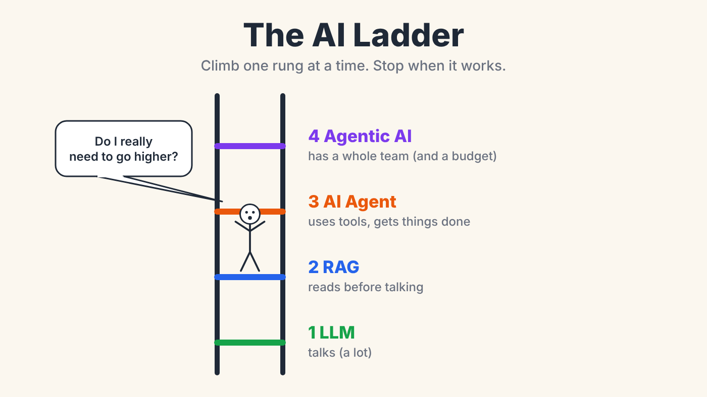
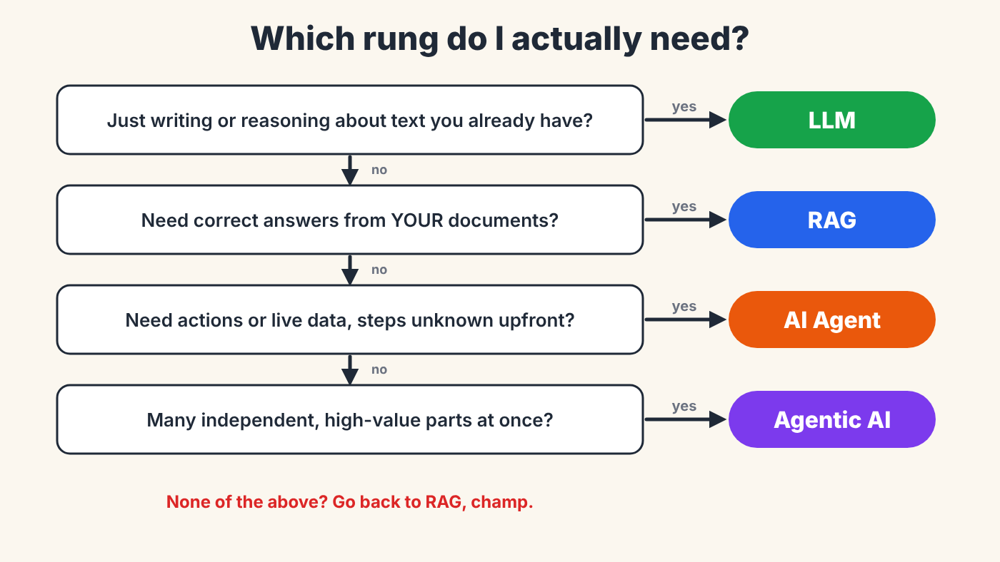

# The AI Ladder: LLM → RAG → Agent → Agentic AI



Companion code for the Medium article
**[LLM, RAG, AI Agent or Agentic AI? Climb the Ladder One Rung at a Time](https://medium.com/@anjubarai004/llm-rag-ai-agent-or-agentic-ai-climb-the-ladder-one-rung-at-a-time-c43367483b7f)**.

Four ways to build with language models, applied to **one** small retail problem, so you can see exactly what each rung adds — and what it costs.

| Rung | File | Adds | Good for |
|---|---|---|---|
| 1. LLM | `step1_llm.py` | — | Writing, summarising, reasoning over text you already have |
| 2. RAG | `step2_rag.py` | Knowledge (retrieval + citations) | Answers from *your* documents |
| 3. Agent | `step3_agent.py` | Tools + a loop | Actions and live data, steps not known in advance |
| 4. Agentic AI | `step4_agentic.py` | Planner → specialists → reviewer | Big tasks with independent parts |

The lesson: **climb only when the rung below visibly fails.**



## Quick start

```bash
git clone https://github.com/Anjub004/ai-ladder.git
cd ai-ladder
pip install -r requirements.txt

# Free local model (needs Ollama: https://ollama.com)
ollama pull llama3.1:8b

python step1_llm.py      # plain LLM: confident, but not based on your policy
python step2_rag.py      # retrieves the policy first, answers with a citation
python step3_agent.py    # calls tools: stock lookup, safe calculator, policy search
python step4_agentic.py  # planner splits the goal, specialists work, reviewer checks
python compare.py        # same questions through every rung: calls, tokens, seconds
```

Prefer a hosted model? Any OpenAI-compatible endpoint works:

```bash
export LLM_BASE_URL=https://your-provider/v1
export LLM_API_KEY=...
export LLM_MODEL=your-model-name
```

## What's inside

```
docs/            Sample store policies (returns, damaged stock, promotions)
stock.csv        Sample stock table (fictional branches and prices)
llm.py           One chat() function + token/call counters
step1_llm.py     Rung 1 — plain LLM
step2_rag.py     Rung 2 — TF-IDF retrieval, relevance threshold, cite-or-refuse prompt
step3_agent.py   Rung 3 — tool-calling loop with step limit and error handling
step4_agentic.py Rung 4 — planner → specialist agents → reviewer
compare.py       Side-by-side comparison of all four rungs
tests/           Offline tests with a scripted fake model (no server needed)
images/          Illustrations from the article
```

All data here is made up for teaching.

## Design choices worth noticing

- **Refuse early.** If retrieval finds nothing relevant, RAG answers "I couldn't find this" *without calling the model*.
- **Never `eval()` model output.** The calculator parses expressions and only allows numbers and `+ - * /`.
- **The model only asks; your code decides.** Tool errors go back to the model as messages instead of crashing the app.
- **Always set a step limit.** `max_steps` stops runaway agent loops.
- **Validate the plan.** The planner's JSON is checked; unknown agents are dropped and subtasks are capped.
- **The reviewer may not add facts.** It combines and flags; it doesn't invent.

## A known weakness (on purpose)

TF-IDF is keyword search. For *"Can a customer return fresh bread…?"* it ranks the 14-day **non-perishable** rule above the correct **bakery** rule, because "bread" and "bakery" are different words. Top-3 retrieval still catches it, but this is exactly how RAG fails quietly. Fixing it with embeddings / hybrid search is the next milestone in **[branch-ops-copilot](https://github.com/Anjub004)** (coming soon).

## Tests

```bash
pytest -q
```

The tests swap the model for a scripted fake, so they check the plumbing — retrieval, refusals, safe calculator, tool dispatch, step limit, plan validation — without any API key. Answers from a real model will vary between models and runs.

## Further reading

- Lewis et al., *Retrieval-Augmented Generation for Knowledge-Intensive NLP Tasks* (2020) — https://arxiv.org/abs/2005.11401
- Yao et al., *ReAct: Synergizing Reasoning and Acting in Language Models* (2022) — https://arxiv.org/abs/2210.03629
- Anthropic, *Building effective agents* (2024) — https://www.anthropic.com/research/building-effective-agents
- Anthropic, *How we built our multi-agent research system* (2025) — https://www.anthropic.com/engineering/multi-agent-research-system
- OWASP Top 10 for LLM Applications — https://genai.owasp.org/llm-top-10/

## License

MIT © Anju Barai
